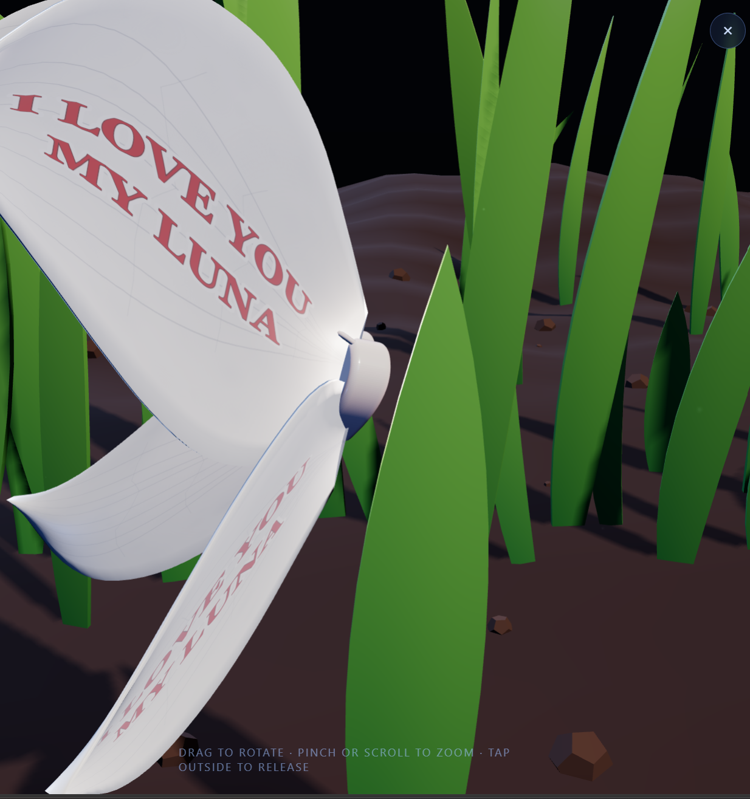
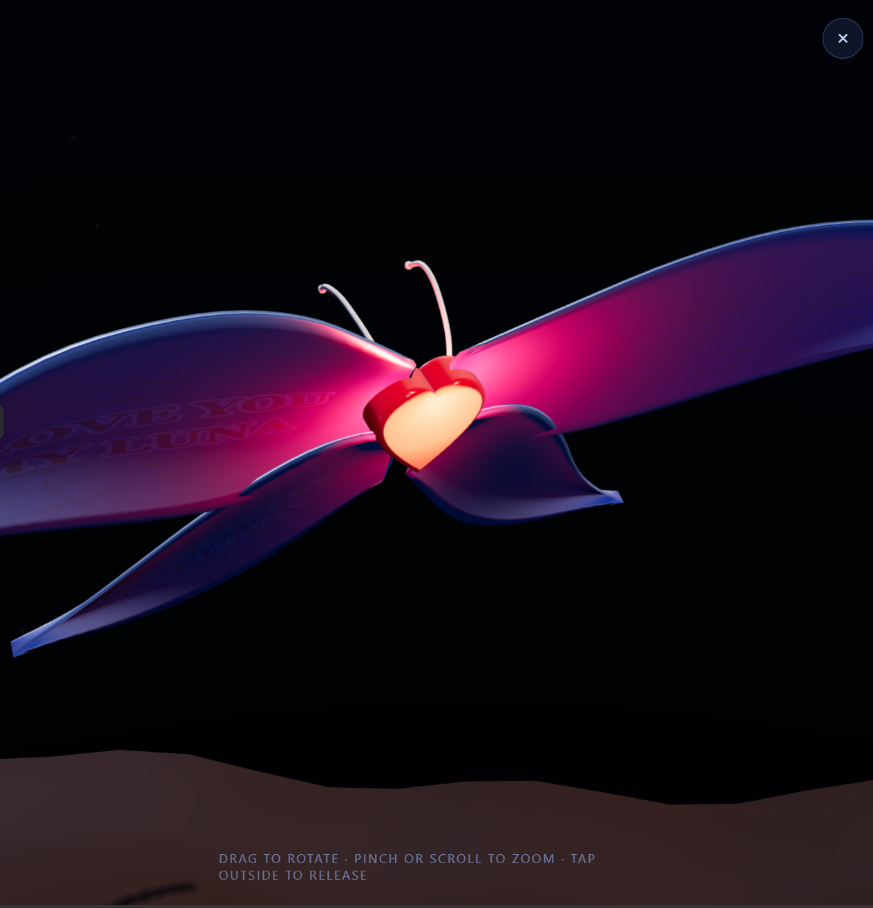
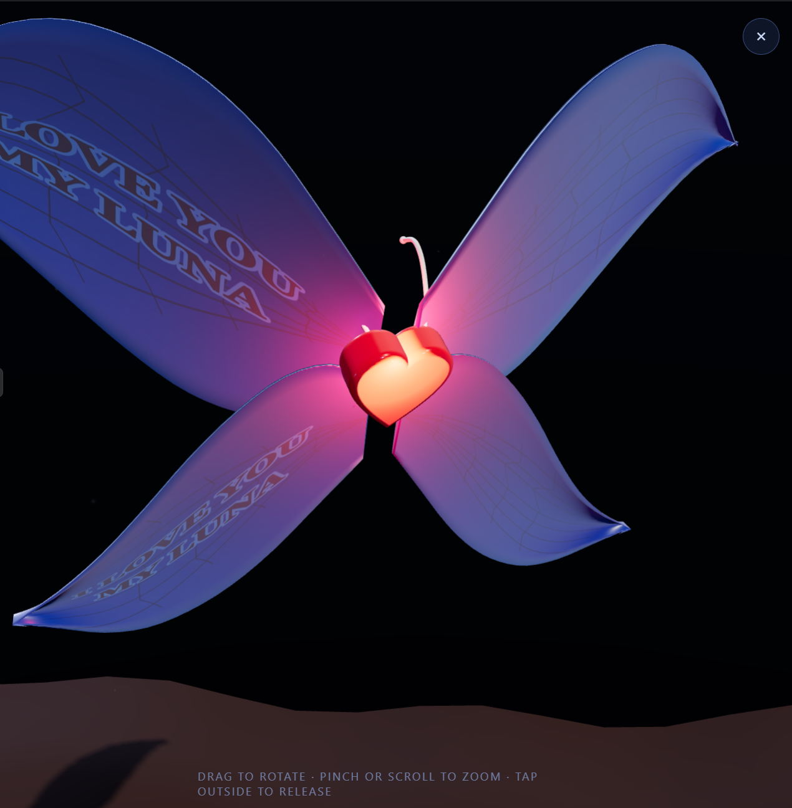
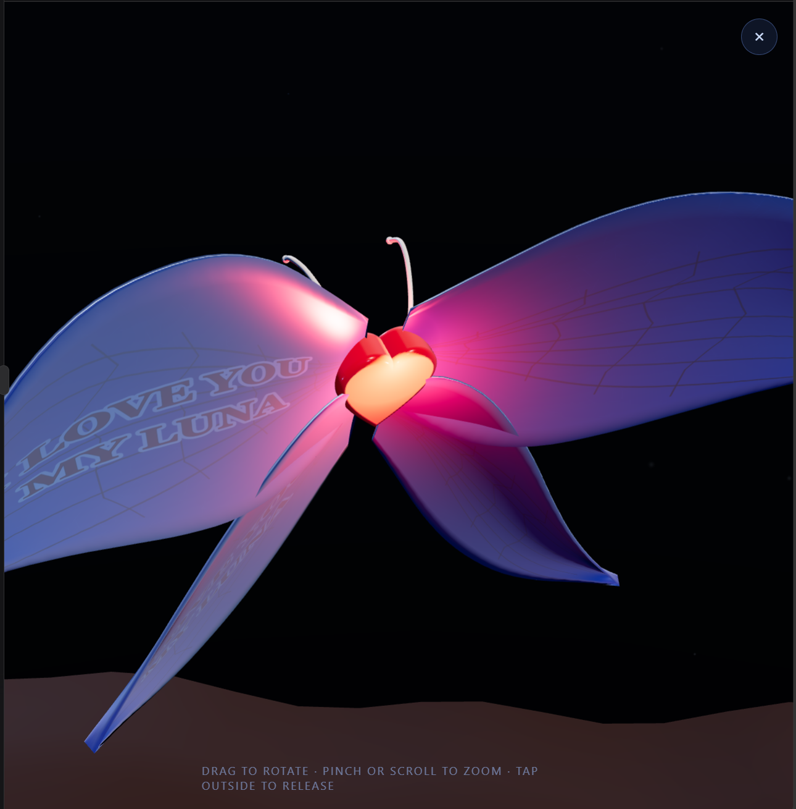

# Heart Butterfly ? Gray to Green

A modular Three.js heart butterfly scene with flight, landing, grass reveal, and recolour animation.

Run locally with `npx serve .` or `python3 -m http.server`.

[View the project on GitHub](https://github.com/wake-bikila-dev/heart-butterfly)

## Screenshots

  
  
  

  

